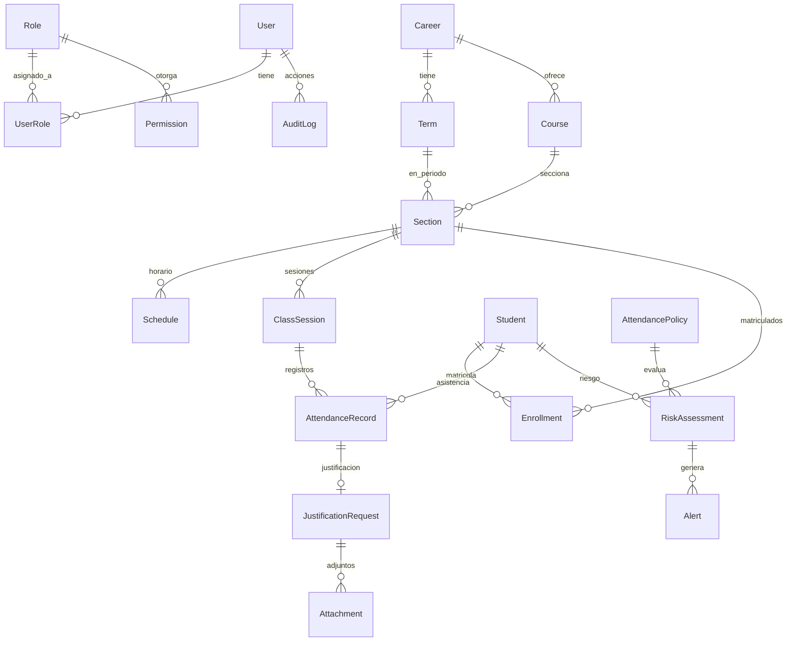
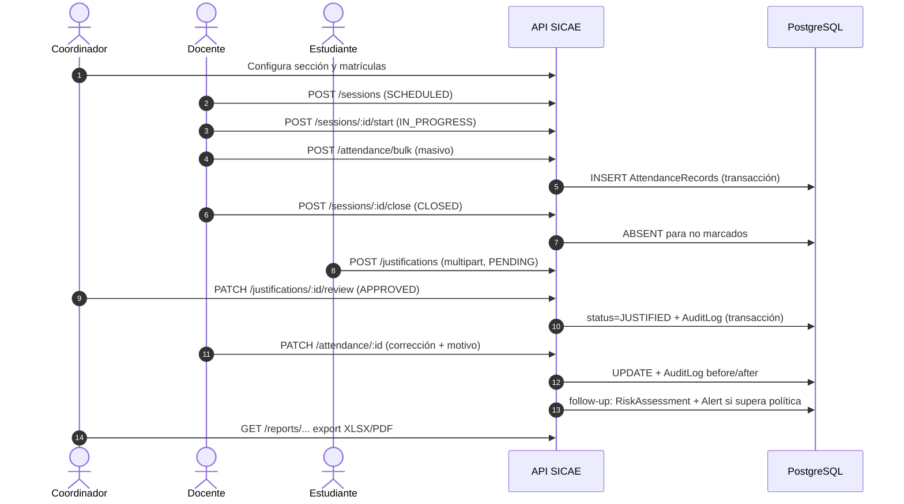

# SICAE — Documento de Arquitectura y Diseño (SAD)

- **Versión**: 1.0
- **Fecha**: 2026-10-15
- **Companion**: `SRS.md` (requisitos), `diccionario-datos.md` (glosario), `../adr/` (decisiones)

## 1. Estilos arquitectónicos

SICAE es un **monolito modular** (modular monolith) desplegable como un único
proceso Node.js, con una **frontera hexagonal ligera por módulo**:

```text
presentation (controladores/dtos)  ──►  application (casos de uso)
                                             │
                                             ▼
infrastructure (Prisma, correo,  ──►  domain (entidades, reglas,
  archivos, auditoría)                    puertos/interfaces)
```

Reglas de dependencia:

- `domain`: entidades, enums, excepciones de negocio y **puertos** (interfaces
  como `AttendanceRepository`). Sin dependencias del framework.
- `application`: casos de uso (`CrearMarcadoMasivo`, `RevisarJustificacion`,
  `EvaluarRiesgo`); orquestan transacciones y emiten eventos internos
  (auditoría, correo). Sin conocimiento de HTTP ni de Prisma.
- `infrastructure`: adaptadores — repositorios Prisma, servicio de correo SMTP,
  almacenamiento local de adjuntos (`ADR-004`), `AuditService`.
- `presentation`: controladores NestJS, DTOs con `class-validator`, guards
  (`@Public()`, `@Roles()`), filtros e interceptores.

Se admite pragmatismo: módulos con CRUD puro pueden comprimir
`domain+application` en un servicio de dominio, siempre que las fronteras de
paquete (`attendance/`, `justification/`, …) se respeten.

Los módulos se comunican por **interfaces de aplicación** (servicios públicos
inyectados), nunca importando Prisma ni repositorios entre módulos.

## 2. Vista de módulos

```text
┌─────────────────────────────  apps/web (React SPA)  ─────────────────────────────┐
│  auth   academic   attendance   justification   alerts   reports   admin users   │
└───────────────────────────────────┬───────────────────────────────────────────────┘
                                    │ HTTPS/JSON  ·  /api/v1
┌───────────────────────────────────▼───────────────────────────────────────────────┐
│ apps/api (NestJS)                                                                  │
│  identity ─► academic ─► enrollment ─► attendance ─► justification                │
│      │                                            │                                │
│      └────────────► followup ◄────────────────────┘                                │
│                        │                                                           │
│         reporting ◄────┘        audit (interceptor global sobre mutaciones)        │
└───────────────────────────────────┬───────────────────────────────────────────────┘
                                    │ Prisma (TCP)
                        ┌───────────▼────────────┐
                        │  PostgreSQL 16 (sicae) │
                        └────────────────────────┘
```

| Módulo | Responsabilidad | Rutas clave (ver `docs/api-routes.md`) |
|---|---|---|
| `identity` | Login JWT, usuarios, roles/permisos, reset de contraseña | `/auth/*`, `/users`, `/roles` |
| `academic` | Carreras, términos, cursos, secciones, horarios, sesiones | `/careers`, `/terms`, `/courses`, `/sections`, `/sessions` |
| `enrollment` | Fichas de estudiantes y matrícula en secciones | `/students`, `/enrollments` |
| `attendance` | Marcado individual/masivo, corrección, resúmenes | `/attendance`, `/attendance/bulk`, `/attendance/summary` |
| `justification` | Solicitudes con adjuntos y revisión | `/justifications`, `/:id/review` |
| `followup` | Políticas, evaluación de riesgo, alertas | `/policies`, `/risk-assessments`, `/alerts` |
| `reporting` | Consultas agregadas y exportación XLSX/PDF | `/reports/*` |
| `audit` | Consulta del registro inmutable | `/audit` |

## 3. Vista de despliegue

```text
                        ┌────────────────────────────┐   perfil "tls"
   navegador ──80/443──►│ nginx (opcional)           │◄── certbot/letsencrypt
                        │  default.conf              │
                        └──────┬─────────────┬───────┘
                               │ /api/       │ /
                        ┌──────▼──────┐ ┌────▼─────────────┐
                        │ api (:3000) │ │ web (:8080)      │
                        │ NestJS      │ │ nginx + SPA      │
                        │ node dist/  │ │ (web.conf)       │
                        └──────┬──────┘ └──────────────────┘
                               │ DATABASE_URL
                        ┌──────▼──────────────────────┐
                        │ postgres:16  (volumen pgdata)│
                        └─────────────────────────────┘
  volúmenes: uploads (adjuntos) · pgdata (datos) · web_dist (estáticos para nginx)
```

- **Desarrollo local**: solo `postgres` en Docker; API y Web corren con `pnpm dev`.
- **Despliegue completo**: `docker compose --env-file .env -f
  infrastructure/docker/docker-compose.yml up -d --build` levanta los cuatro
  servicios (nginx bajo el perfil `tls`).
- El frontend conoce la API por `VITE_API_URL` (inyectada en el build); por
  defecto `/api/v1` resuelta por el proxy de nginx.
- El API es **stateless**: puede replicarse; el estado vive en PostgreSQL y en
  los volúmenes `pgdata`/`uploads`.

## 4. Vista de datos



Notas:

- Identificadores `UUID` (Prisma `@id @default(uuid())`) salvo catálogos
  pequeños; timestamps `createdAt`/`updatedAt` en todas las entidades.
- `AttendanceRecord` tiene unicidad `(sessionId, studentId)`; el estado
  `JUSTIFIED` solo llega vía aprobación de justificación (RF-JU-04).
- `AuditLog` es de solo inserción; `before`/`after` son `Json` con el snapshot.

## 5. Flujo del proceso de asistencia

Pasos numerados del flujo principal (coherente con `docs/api-routes.md`):

1. El **coordinador/ADMIN** configura carrera → término → curso → sección
   (`/careers`, `/terms`, `/courses`, `/sections`) y matricula estudiantes
   (`/enrollments`).
2. El **DOCENTE** crea la sesión de clase para la sección (`POST /sessions`,
   estado `SCHEDULED`).
3. Al comenzar la clase, el docente la inicia (`POST /sessions/:id/start` →
   `IN_PROGRESS`).
4. El docente **marca asistencia**: individual (`POST /attendance`) o masiva
   (`POST /attendance/bulk`) con estados `PRESENT`/`ABSENT`/`LATE`.
5. El docente **cierra la sesión** (`POST /sessions/:id/close` → `CLOSED`); los
   matriculados sin marcado quedan `ABSENT` (RF-AT-06).
6. Si un estudiante falta, **sube una justificación** con motivo y adjuntos
   (`POST /justifications`, estado `PENDING`).
7. El **coordinador revisa** (`PATCH /justifications/:id/review`): al
   `APPROVED`, el registro de asistencia pasa a `JUSTIFIED` y se audita; al
   `REJECTED`, permanece `ABSENT`.
8. Toda **corrección** de asistencia por el docente (`PATCH /attendance/:id`,
   con motivo) genera entrada en `AuditLog` con antes/después.
9. El sistema de **follow-up** evalúa al estudiante contra las políticas
   activas (máximo de ausencias y/o % de umbral) → `RiskAssessment` con nivel
   y creación de `Alert` si procede (`POST /risk-assessments/run`).
10. El coordinador gestiona la alerta (`ACK` → `RESOLVED`) y **reporting**
    exporta XLSX/PDF (`/reports/*`).



## 6. Manejo de errores y observabilidad

- **Filtro global de excepciones**: responde siempre
  `{ statusCode, message | message[], error }` (contrato en
  `docs/api-routes.md`). Las excepciones de negocio (`NotFoundException`,
  `ForbiddenException`, `BusinessRuleException`) se traducen a mensajes en
  español; los errores internos **nunca** filtran stack traces en producción.
- **Validación**: `ValidationPipe` global con `whitelist` y `transform`;
  los DTOs son la única superficie de entrada.
- **Logging**: `Logger` de NestJS con contexto por módulo; cada request lleva
  un `x-request-id` generado por el filtro de entrada y devuelto en la
  respuesta para correlación en logs. Logs estructurados en stdout (formato
  JSON en producción) para su ingesta por el runtime de contenedores.
- **Salud**: endpoint `GET /api/v1/health` (comprobación de proceso) y
  `HEALTHCHECK` en los Dockerfiles y en el compose (API, web, postgres).
- **Auditoría de negocio**: `AuditInterceptor` (ADR-005) con degradación
  controlada: si falla el `AuditLog`, se loguea el error sin romper la
  operación principal.
- **Métricas** (futuro): `/metrics` con prom-client detrás del proxy; fuera del
  alcance actual.

## 7. Seguridad

| Capa | Medida |
|---|---|
| Transporte | TLS en el proxy (perfil `tls`, certbot); HTTP solo en desarrollo |
| Perímetro | Rate limit 10 r/s por IP en `/api/` (nginx) y CORS restringido a `WEB_ORIGIN` |
| Autenticación | JWT (8 h) + argon2; endpoints públicos solo vía `@Public()` (ADR-003) |
| Autorización | `RolesGuard` + `@Roles(...)` por ruta; reglas de dueño en caso de uso |
| Aplicación | Validación de entrada, mensajes genéricos en credenciales, uploads con MIME/tamaño permitidos y nombres UUID |
| Datos | Secretos solo en `.env` (gitignorado); argon2 nunca MD5/SHA; parametrización vía Prisma |
| Cabeceras | `X-Frame-Options: DENY`, `nosniff`, `Referrer-Policy`, CSP, ocultación de versión (nginx.conf) |
| Registro | `AuditLog` inmutable para trazabilidad de correcciones |

## 8. Riesgos y mitigación

| Riesgo | Impacto | Mitigación |
|---|---|---|
| Desincronización del contrato API ↔ Web | Alto | `docs/api-routes.md` como fuente de verdad; CI que compila ambos paquetes; e2e Playwright (pendiente de activar en CI) |
| Pérdida del volumen `uploads` (fallo de disco) | Medio | Volumen Docker persistente + copia en el plan de backup (ADR-004) |
| Olvido de auditar nuevas mutaciones | Alto | Anotación `@Auditable` obligatoria en PR + tests de integración por flujo crítico |
| Token JWT no revocable | Medio | Expiración 8 h, desactivación lógica verificada en guard, rotación de secreto |
| Rendimiento de reportes sobre datos grandes | Medio | Paginación, agregados con índices en `(sessionId)`, `(studentId)` y fechas; exportación por streaming |
| Cuello de botella del marcado masivo | Medio | Una transacción por bulk, índices de unicidad `(sessionId, studentId)` |
| Dependencia de un solo host (BD + adjuntos) | Alto | Copias horarias con retención 7 días (`infrastructure/scripts/backup.sh`), restauración probada (`restore.sh`) |
| Deriva de entornos («en mi máquina sí») | Bajo | Imágenes Docker fijadas, `pnpm install --frozen-lockfile`, CI en Ubuntu |
